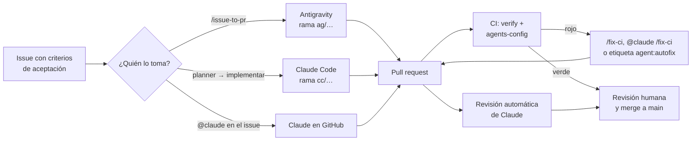
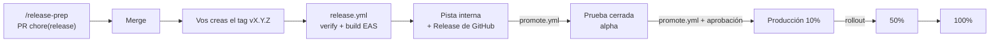

# Flujo agéntico de LudiKordo

Cómo trabajan juntos Antigravity, Claude Code y GitHub para desarrollar, probar y publicar la app. Las reglas que siguen los agentes están en `AGENTS.md`; esta guía es para las personas.

## Quién hace qué

| Actor | Dónde corre | Para qué conviene | Qué no hace |
| --- | --- | --- | --- |
| **Antigravity** | Tu computadora, Agent Manager | Tareas grandes con plan visible (Implementation Plan), varias tareas en paralelo en distintos workspaces, lecciones nuevas, investigar documentación con su navegador | Merge, tags, deploy |
| **Claude Code local** | Tu terminal o IDE | Implementación con subagentes especializados (pruebas, audio nativo, traducciones, revisión), refactors, el módulo Kotlin, preparar versiones | Merge, tags, deploy, `eas build/submit` (bloqueados en `.claude/settings.json`) |
| **Claude en GitHub** | GitHub Actions | Revisión automática de cada PR; responder a `@claude` en issues y PR (implementar un issue, arreglar CI con `@claude /fix-ci`); autofix de CI con la etiqueta `agent:autofix` | Merge, deploy |
| **GitHub Actions** | GitHub | CI obligatorio, compilación nativa, APK de prueba, build y envío a Google Play, promoción entre pistas | Decidir: todo lo irreversible pide una persona |
| **Vos** | — | Escribir issues claros, aprobar planes, revisar y hacer merge, crear tags, aprobar la promoción a producción | — |

Regla de oro: **los agentes proponen por PR; las personas hacen merge y publican.**

## Ciclo de una tarea



1. **Issue**: usa las plantillas (Funcionalidad, Lección nueva, Error). Los criterios de aceptación verificables son lo que más mejora el trabajo de un agente.
2. **Asignación**: elige la herramienta según la tabla de arriba y márcala en el issue.
3. **Plan**: Antigravity lo deja como Implementation Plan; Claude Code con el subagente `planner`. Revísalo antes de que escriba código si la tarea es grande.
4. **Rama y worktree**: `ag/<issue>-<slug>` o `cc/<issue>-<slug>`, cada una en su carpeta.
5. **Implementación y verificación**: el agente termina con `npm run verify`. En Claude Code un hook no lo deja terminar si las pruebas o los tipos fallan.
6. **PR**: con la plantilla completa (skill `ship-pr`). CI y la revisión de Claude corren solas.
7. **Merge**: vos, con CI en verde y los comentarios resueltos.

## Trabajar en paralelo sin pisarse

Cada agente trabaja en su propio *worktree* (una carpeta por rama, mismo repositorio):

```bash
git fetch origin
git worktree add ../ludikordo-ag-42 -b ag/42-leccion-1-3-2 origin/main   # Antigravity
git worktree add ../ludikordo-cc-43 -b cc/43-tempo-trainer origin/main     # Claude Code
cd ../ludikordo-ag-42 && npm ci
```

- En Antigravity, abre cada worktree como un workspace distinto del Agent Manager.
- En Claude Code, abre `claude` dentro de la carpeta del worktree.
- Al terminar: `git worktree remove ../ludikordo-ag-42` después del merge.
- Evita que dos tareas paralelas toquen los mismos archivos de traducciones: si pasa, mergea una y haz rebase de la otra (`git rebase origin/main`) antes de seguir.

## Recetas

### Funcionalidad nueva
- Antigravity: `/issue-to-pr 42`.
- Claude Code: «Toma el issue #42» → usa `planner`, implementa, `code-reviewer`, `/ship-pr`.

### Lecciones nuevas
- Antigravity: `/new-lesson 1.3.2`. Claude Code: subagente `content-author` o skill `/add-lesson`. Máximo 5 lecciones por PR; pide revisión a `i18n-reviewer` si no la hizo el autor.

### Error reportado
- Pide primero una prueba que falle (`test-engineer`), después el arreglo. Si es de audio o detección, `audio-native`.

### CI en rojo
- En tu máquina: `/fix-ci <PR>` (Antigravity) o `/fix-ci` (Claude Code).
- En GitHub: comenta `@claude /fix-ci` en el PR, o pon la etiqueta `agent:autofix` para un intento automático (la etiqueta se quita sola).

### Diseño y cartoons
- Pantallas: regla `design` (Antigravity) y skills `expo-design-system`, `expo-animation`; verificación con el MCP `mobile` y capturas en el PR.
- Cartoons: skill `make-cartoon` siguiendo `docs/CARTOON_PIPELINE.md` (storyboard → Rive → voces → integración). Activa antes los MCP `rive`, `elevenlabs` y `nanobanana` con `npm run mcp:optional -- add <nombre>`.

### Pruebas E2E
- Local: emulador encendido y `npm run e2e` (flujos en `.maestro/`).
- En GitHub: etiqueta `test:e2e` en el PR.

### Cambiar las reglas de los agentes
- Reglas comunes: `AGENTS.md`. Solo Antigravity: `.agents/rules/` (cada archivo con `trigger`). Solo Claude Code: `CLAUDE.md`, `.claude/agents/`, `.claude/settings.json`.
- Skills: siempre en `.agents/skills/`, después `npm run sync:skills` y commitear también `.claude/skills/`. CI (`agents-config`) falla si quedaron desincronizadas o si una regla no tiene `trigger` válido.

## Publicar en Google Play



1. **Preparar**: un agente corre `/release-prep`: versión semver en `app.json`, `CHANGELOG.md` y notas en `release-notes/vX.Y.Z/` (en-US, es-419, pt-BR). Ponle la etiqueta `build:preview` al PR y prueba el APK en un teléfono y una tablet.
2. **Tag**: después del merge, `git switch main && git pull && git tag vX.Y.Z && git push origin vX.Y.Z`. Solo personas.
3. **Build y pista interna**: `release.yml` verifica que el tag esté sobre `main` y coincida con `app.json`, construye en EAS (el `versionCode` sube solo) y lo envía a la pista interna. Crea un Release de GitHub con el `versionCode`.
4. **Promover**: Actions → `promote` → `promote`, con el `versionCode`, de `internal` a `alpha` (prueba cerrada). Después de unos días sin errores, de `alpha` a `production` con `rollout` 0.1.
5. **Ampliar**: `promote` → `rollout` con 0.5 y luego 1. Cada corrida en `play-production` espera tu aprobación.

Las notas de «Novedades» de Google Play se cargan en Play Console al promover (el flujo todavía no las sube solo).

## Barreras de seguridad y dónde viven

| Riesgo | Barrera |
| --- | --- |
| Un agente publica en la tienda | `eas build/submit` bloqueados en `.claude/settings.json`; regla en `AGENTS.md`; solo `release.yml` y `promote.yml` tienen las credenciales |
| Push directo o forzado a main | Protección de rama (PR obligatorio, sin force push) + permisos de Claude Code |
| Código roto llega a main | Checks obligatorios `verify` y `agents-config`; hook Stop de Claude Code |
| Textos en un solo idioma | `check:i18n` en hook, CI y prueba de contenido |
| YIN cambiado de un solo lado | Hook post-edición de Claude Code; regla `audio-native` de Antigravity; revisión |
| Cambios en pagos, deploy o reglas de agentes | `CODEOWNERS` + permisos `ask` en Claude Code |
| Bucle de autofix | Un intento por etiqueta; la etiqueta se quita al terminar |
| Secretos expuestos | Lectura de `.env*` y claves bloqueada; claves solo en GitHub Secrets y EAS |
| Promoción accidental a producción | Entorno `play-production` con aprobación obligatoria |

## Puesta en marcha (una vez)

1. `npm install`, `npx expo install --fix` y commitear `package-lock.json` (CI usa `npm ci`).
2. Crear el repositorio en GitHub y hacer push de `main`.
3. `scripts/github/setup-repo.sh` (etiquetas, entornos, protección de `main`). Si trabajas solo, deja `APPROVALS=0`: GitHub no permite aprobar tus propios PR.
4. Reemplazar `REEMPLAZAR-usuario` en `.github/CODEOWNERS`.
5. Instalar la GitHub App de Claude y cargar `ANTHROPIC_API_KEY` (o `CLAUDE_CODE_OAUTH_TOKEN`, generándolo con `claude setup-token` y cambiando el input en los 3 workflows de Claude). Atajo: `/install-github-app` dentro de Claude Code.
6. Expo: `eas init`, crear un token de robot y cargarlo como `EXPO_TOKEN`.
7. Google Play: crear la app `app.ludikordo`, una cuenta de servicio con acceso a la app; cargar su JSON en EAS (`eas credentials`) y en el secreto `GOOGLE_PLAY_SERVICE_ACCOUNT_JSON` del entorno `play-production`. El **primer** AAB se sube a mano en Play Console (Google lo exige); desde el segundo, todo por `release.yml`.
8. Antigravity: abrir la carpeta del repo como workspace; lee `AGENTS.md`, `.agents/rules/`, `.agents/skills/` y `.agents/workflows/` solo.
9. Claude Code: `claude` en la carpeta del repo; lee `CLAUDE.md` (que importa `AGENTS.md`), `.claude/agents/`, `.claude/skills/` y los hooks. Aprueba los hooks del proyecto cuando lo pida.
10. Herramientas: `npm run skills:external` (revisar el diff y commitear), aprobar los MCPs de `.mcp.json` en Claude Code, refrescar los MCP en Antigravity, y `npx expo install expo-mcp --dev` para las capacidades locales del MCP de Expo. Catálogo y opcionales en `docs/TOOLING.md`.

## Mapa de archivos

```
AGENTS.md                      reglas comunes (Antigravity, Claude Code y otros)
CLAUDE.md                      importa AGENTS.md + lo propio de Claude Code
.agents/
  rules/                       reglas de Antigravity con trigger (always_on, glob, model_decision)
  skills/                      skills compartidas (fuente)
  workflows/                   comandos /… de Antigravity
.claude/
  agents/                      subagentes de Claude Code
  skills/                      copia generada de .agents/skills (no editar)
  settings.json                permisos y hooks
.github/
  workflows/ci.yml             verify + agents-config (obligatorios)
  workflows/native-android.yml compila Android cuando cambia lo nativo
  workflows/claude.yml         @claude en issues y PR
  workflows/claude-review.yml  revisión automática de PR
  workflows/claude-autofix.yml arreglo de CI con la etiqueta agent:autofix
  workflows/eas-preview.yml    APK de prueba con la etiqueta build:preview
  workflows/release.yml        tag → build EAS → pista interna
  workflows/promote.yml        pista interna → cerrada → producción escalonada
  CODEOWNERS, plantillas, dependabot.yml
scripts/
  check-i18n.mjs               paridad de traducciones
  agents/                      sincronización de skills, validación de config, hooks
  github/setup-repo.sh         etiquetas, entornos y protección de main
```
